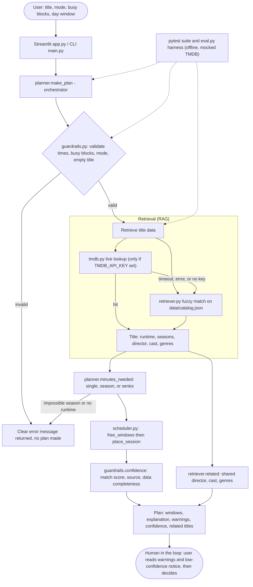

# ShowTime Planner

A free-time planner for movies and TV. You block out your busy hours, name something to watch, and choose a mode: one episode or movie, binge a season, or find out how long the whole series takes. The system retrieves the title's real data (runtime, episodes per season, cast, director), works out how many minutes you need, fits that into your free windows, and tells you how confident it is.

## Base project: PawPal+ (Module 2)

ShowTime Planner extends **PawPal+**, my Module 2 Streamlit app for pet owners. PawPal+ let a user add pets and care tasks, sorted tasks by time across pets, warned about same-time conflicts, and created the next task when a daily or weekly task was completed. It had four classes (Task, Pet, Owner, Scheduler) and 10 unit tests. The original code is still in the repo (`pawpal_system.py`, `tests/test_pawpal.py`, `reflection.md`, and the `diagrams/uml*.mmd` files) and its tests still pass. The conflict-detection idea became the free-window and overlap logic in ShowTime Planner.

## What is new (the AI feature)

- **RAG with two sources.** The planner retrieves title data before it answers, and the retrieved numbers decide the result. A bundled catalog (`data/catalog.json`, 21 titles) always works offline. If a TMDB key is set, TMDB is searched too, and the closer name match wins. Any live failure falls back to the catalog.
- **Related titles by retrieval.** Suggestions are ranked by shared director/creator, shared cast, and shared genre, with the reason shown.
- **Guardrails.** Bad times, reversed ranges, unknown modes, empty titles, impossible seasons, and missing runtimes return a clear error instead of a plan. Overlapping busy blocks and fuzzy title matches produce warnings.
- **Confidence score (0 to 1)** from title-match quality, data source, and data completeness. The UI shows a low-confidence notice below 0.7.
- **Evaluation harness** (`eval.py`) with 13 predefined cases, plus a 50-test pytest suite.

## Architecture overview

Source: [diagrams/architecture.mmd](diagrams/architecture.mmd)



Flow: the UI (Streamlit or CLI) calls `planner.make_plan`. Guardrails validate the input first. Retrieval then looks the title up (TMDB if available, else the catalog). The planner computes the minutes needed for the chosen mode, `scheduler.py` finds free windows and places the session, and `guardrails.confidence` scores the result. The user sees the plan, warnings, confidence, and related titles, and decides what to do. That is the human-in-the-loop step. Tests and `eval.py` run offline against the planner, guardrails, and retriever.

## Setup

```bash
python -m venv .venv
source .venv/bin/activate        # Windows PowerShell: .\.venv\Scripts\Activate.ps1
python -m pip install --upgrade pip
pip install -r requirements.txt
```

Optional live data: get a free TMDB API key and set it. Never commit it (`.env` is gitignored).

```bash
export TMDB_API_KEY=your_key      # or put TMDB_API_KEY=your_key in a file named .env
```

Without a key everything still works using the bundled catalog.

## Run and test

```bash
python main.py            # CLI demo, 6 cases (add --live to use TMDB)
streamlit run app.py      # web UI
python eval.py            # evaluation harness (offline)
python -m pytest          # all tests (offline, TMDB is mocked)
```

## Sample interactions

Busy blocks for all runs: 09:00-12:00 work, 13:00-17:30 work, 18:30-19:30 dinner. Day window 08:00-23:00. Output below is pasted from `python main.py` (offline catalog mode). The full file is [assets/demo_output.txt](assets/demo_output.txt).

```
ShowTime Planner demo (busy: 09:00-12:00 work, 13:00-17:30 work, 18:30-19:30 dinner)
============================================================
Movie tonight: title='Inception' mode=single season=1
  Retrieved 'Inception' (2010, source: catalog); runtime 148m per movie.
  Mode 'single' needs 2h 28m for the movie.
  Free time today: 6h 30m in 4 window(s).
  Everything fits today.
  Watch 08:00-09:00 (1h)
  Watch 12:00-13:00 (1h)
  Watch 17:30-17:58 (28m)
  Confidence: 0.95
  Also try: Interstellar (same director/creator (Christopher Nolan); shared genre: sci-fi)
  Also try: The Dark Knight (same director/creator (Christopher Nolan))
  Also try: The Prestige (same director/creator (Christopher Nolan))
============================================================
Binge season 1 (typo in title): title='breaking bda' mode=season season=1
  Warning: Matched 'breaking bda' to 'Breaking Bad' (score 0.92); please confirm
  Retrieved 'Breaking Bad' (2008, source: catalog); runtime 47m per episode.
  Mode 'season' needs 5h 29m for season 1 (7 episodes).
  Free time today: 6h 30m in 4 window(s).
  Everything fits today.
  Watch 08:00-09:00 (1h)
  Watch 12:00-13:00 (1h)
  Watch 17:30-18:30 (1h)
  Watch 19:30-21:59 (2h 29m)
  Confidence: 0.9
  Also try: Better Call Saul (same director/creator (Vince Gilligan); shared genre: crime, drama)
  Also try: Sherlock (shared genre: crime)
  Also try: Arrival (shared genre: drama)
============================================================
How long to finish the series: title='The Office' mode=series season=1
  Retrieved 'The Office' (2005, source: catalog); runtime 22m per episode.
  Mode 'series' needs 69h 40m for the full series (9 seasons, 190 episodes).
  Free time today: 6h 30m in 4 window(s).
  Only part fits today; 63h 10m left over (about 11 days at this free time).
  Watch 08:00-09:00 (1h)
  Watch 12:00-13:00 (1h)
  Watch 17:30-18:30 (1h)
  Watch 19:30-23:00 (3h 30m)
  Confidence: 0.95
  Also try: Parks and Recreation (shared genre: comedy)
  Also try: Knives Out (shared genre: comedy)
============================================================
Guardrail: impossible season: title='Dark' mode=season season=9
  ERROR: 'Dark' has no season 9 (has [1, 2, 3])
============================================================
Guardrail: bad busy time: title='Arcane' mode=single season=1
  ERROR: Busy block 'oops': '25:00' is out of range
============================================================
Guardrail: unknown title: title='Not A Real Show' mode=single season=1
  ERROR: No title found for 'Not A Real Show' (best match score 0.4)
```

What to notice:
1. **Inception, single:** retrieved a 148 minute runtime, split it across three free windows, and suggested other Christopher Nolan films with the reason.
2. **"breaking bda", season 1:** the typo was fuzzy-matched to Breaking Bad, a warning asked for confirmation, and confidence dropped from 0.95 to 0.9. Seven episodes of 47 minutes came from retrieved data.
3. **The Office, series:** 190 episodes at 22 minutes is 69h 40m. Only part fits today, so it reports about 11 days at this free time.
4. **Guardrails:** an impossible season, an invalid time, and an unknown title each return an error and no plan.

### Multi-source retrieval, before and after (RAG enhancement)

The bundled catalog has no "The Boys". Adding TMDB as a second source lets the same request succeed. Pasted from a real run with a TMDB key ([assets/live_before_after.txt](assets/live_before_after.txt)). Live output depends on TMDB's current data.

```
OFFLINE (no TMDB): The Boys, season 1
  ERROR: No title found for 'The Boys' (best match score 0.56)

LIVE (TMDB): The Boys, season 1
  Retrieved 'The Boys' (2019, source: tmdb); runtime 59m per episode.
  Mode 'season' needs 7h 52m for season 1 (8 episodes).
  Free time today: 7h 30m in 3 window(s).
  Only part fits today; 22m left over (about 2 days at this free time).
  Watch 08:00-09:00 (1h)
  Watch 12:00-13:00 (1h)
  Watch 17:30-23:00 (5h 30m)
  Confidence: 1.0
```

The live title also pulls related suggestions from the catalog when cast, director, or genre overlap (for example, a live search for Oppenheimer suggested Interstellar, The Prestige, and Inception because of Christopher Nolan).

## Reliability and guardrail results

Evaluation harness, pasted from `python eval.py` ([assets/eval_output.txt](assets/eval_output.txt)):

```
case                    result  conf   expected
----------------------------------------------------------------------
exact movie             PASS    0.95   ok, 148 min, conf >= 0.9
typo title              PASS    0.9    fuzzy match plus warning
season binge minutes    PASS    0.95   8 episodes x 55 min
series total            PASS    0.95   12 episodes x 88 min
related by director     PASS    0.95   top related is same director
movie in season mode    PASS    0.95   warns, treated as single
impossible season       PASS    -      blocked with error
bad busy time           PASS    -      blocked with error
end before start        PASS    -      blocked with error
unknown title           PASS    -      blocked with error
empty title             PASS    -      blocked with error
fully busy day          PASS    0.95   ok, nothing scheduled
live failure fallback   PASS    0.85   falls back to catalog
----------------------------------------------------------------------
13/13 passed | average confidence on accepted plans: 0.93
```

Pytest, pasted from `python -m pytest -q` ([assets/pytest_output.txt](assets/pytest_output.txt)):

```
..................................................                       [100%]
50 passed in 2.00s
```

## Design decisions and trade-offs

- **Offline catalog first, live API second.** Anyone can clone and run this without a key, and tests never need the network. The cost is a small catalog (21 titles).
- **Rules plus retrieval instead of an LLM.** Runtime math and window fitting must be exact, so I did not let a model do arithmetic. An LLM re-ranker or explainer is a possible later add-on.
- **TMDB, not IMDb.** IMDb has no free public API. TMDB has movies, TV, cast, crew, and per-episode runtimes. TV `episode_run_time` is often empty, so the code falls back to the median of real episode runtimes.
- **Single-day planning, greedy placement.** The first free windows are used in order. It does not optimize for the best time of day or avoid splitting a movie across windows.
- **Catalog beats a worse live match.** I compared the catalog with TMDB and found that a live search for "Dark" returned Dark Shadows (1966), and "Avatar: The Last Airbender" returned the 2024 remake. The planner now keeps the catalog title when its name match is closer, and says so in a warning.
- **Minimum 20 minute window.** Tiny gaps are skipped unless they finish the session.
- **Confidence is a heuristic**, not a calibrated probability.

## Testing summary

- 50 pytest tests pass and the harness passes 13 of 13 cases. Average confidence on accepted plans was 0.93.
- What worked: fuzzy matching, season and series math, guardrail errors, offline fallback when the live lookup fails.
- What did not work at first: related titles for The Office ranked a movie above Parks and Recreation until I added a same-kind bonus. Live matches also started with a flat confidence of 1.0, which was too trusting, so it now uses name similarity.
- Still weak: a typo in a live search (for example "oppenheimr") finds nothing on TMDB and nothing in the catalog, so it errors. TMDB's top search result can also be the wrong title.
- Catalog check: I compared all 21 catalog titles against TMDB. Most matched. Fixed Stranger Things (season 5 added, typical runtime 50). Left The Office seasons 6 and 7 and Parks and Recreation seasons 6 and 7 as is: TMDB counts them as 24/24 and 20/12 episodes versus my 26/26 and 22/13, probably because it merges double-length episodes. Cast lists differ from TMDB in billing order only.
- Not tested: the real TMDB API in automated tests (mocked on purpose), and the Streamlit UI beyond two smoke tests.

## Reflection

See [model_card.md](model_card.md) for the full responsible-AI reflection. Short version: the part that made this trustworthy was not the retrieval itself but the checks around it: validating input, showing when data came from a fuzzy match, and falling back safely.

## Portfolio note

This project shows that I can take a working prototype and turn it into a system that retrieves data, checks its own inputs, reports uncertainty, and proves its behavior with tests. Code: https://github.com/LimberLumberSlumber/applied-ai-system-project

Loom walkthrough: not recorded.

This product uses the TMDB API but is not endorsed or certified by TMDB.
